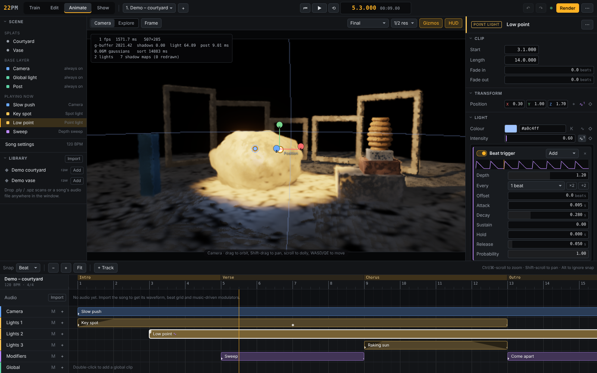

# 22PM

Gaussian-splat concert visuals for jóvilágvan's Délután 10 tour. Splats are the set; virtual lights are the performers; every song is a deterministic timeline locked to the click.

```bash
npm install
npm run dev
```

Open http://127.0.0.1:5173 in Chrome (or another WebGPU browser). The app starts with a procedural demo scene so the lighting tools can be tried before a real scan exists. Drop `.ply` / `.spz` scans or a song's audio file anywhere in the window.



- Brief and build guide: [`docs/BRIEF.md`](docs/BRIEF.md)
- What is built, what is not, and what to try: [`docs/STATUS.md`](docs/STATUS.md)
